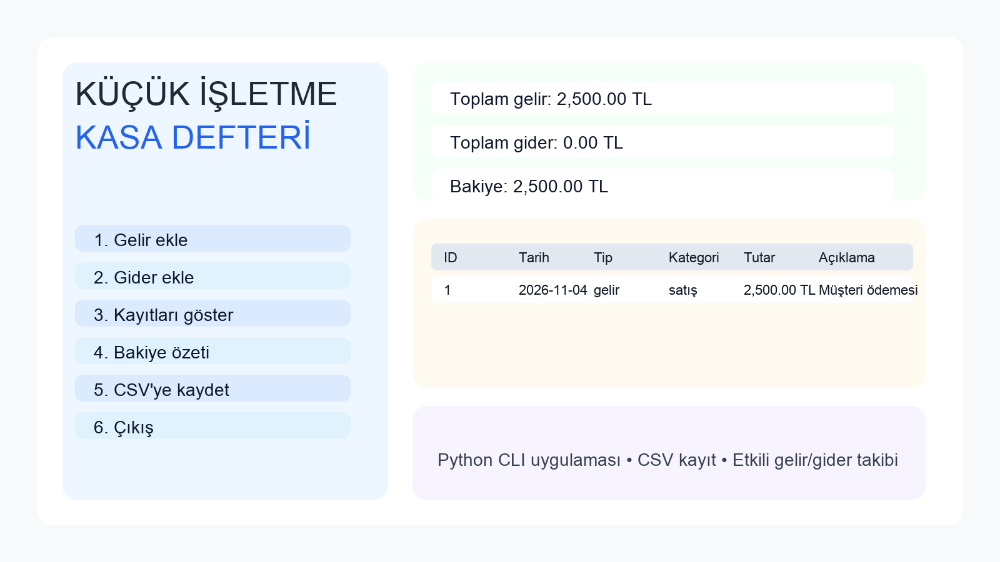

# Küçük İşletme Kasa Defteri

Bu proje, küçük bir işletmenin günlük gelir ve gider kaydını tutan basit bir komut satırı uygulamasıdır. Kullanıcılar gelir ve gider ekleyebilir, mevcut bakiyeyi görebilir ve tüm kaydı `.csv` dosyasına aktarabilir.

GitHub deposu: https://github.com/BAUtku/gep1316-odev1-kasa-defteri

## Özellikler

- Gelir ve gider kaydı ekleme
- En az 3 girdi doğrulaması
- En az 2 karar yapısı (`if` / `else`)
- Menü tabanlı döngü
- En az 3 fonksiyon
- Liste ve sözlük kullanımı
- Biçimlendirilmiş çıktı ve CSV kaydı
- Test senaryoları

## Çalıştırma

```bash
cd kasa_defteri
python3 kasa_defteri.py
```

## Kullanım örneği

1. Menüden `1` seçerek gelir ekleyin.
2. Kategori, açıklama, tutar ve tarih girin.
3. Menüden `3` ile tüm kayıtları görün.
4. Menüden `4` ile bakiye özetini alın.
5. Menüden `5` ile veriyi `transactions.csv` dosyasına kaydedin.

## Test çalıştırma

```bash
cd kasa_defteri
python3 -m unittest -q
```

## Ekran görüntüsü



## Örnek çıktı

```text
=== KÜÇÜK İŞLETME KASA DEFTERİ ===
1. Gelir ekle
2. Gider ekle
3. Kayıtları göster
4. Bakiye özeti
5. CSV'ye kaydet
6. Çıkış
```

## Yapılabilecek geliştirmeler

- Ürün stok takibi
- Aylık rapor özeti
- Grafiksel çıktı
- JSON dosya desteği

## GitHub için hazırlanma

Bu proje GitHub üzerinde yayınlanmıştır ve yerel repo hazırdır. İsterseniz aynı klasör içindeki dosyaları teslim için düzenleyebilirsiniz.
